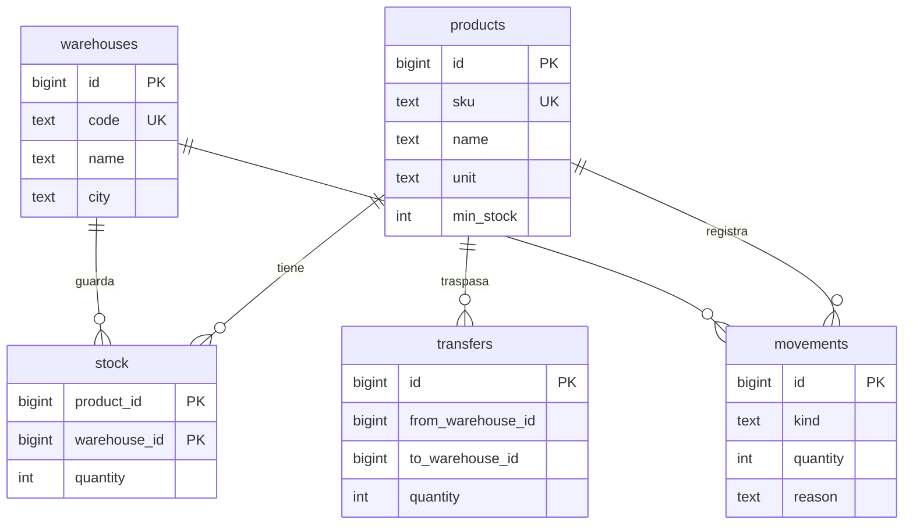

# Arquitectura

Servicio HTTP en Go con la biblioteca estándar (`net/http`, enrutado por método y comodines
de Go 1.22+) y PostgreSQL 16 mediante `pgx`. Sin framework web ni ORM.

## Paquetes

| Paquete | Responsabilidad |
| --- | --- |
| `cmd/api` | Arranque del servidor: lee `DATABASE_URL` y `PORT`, crea el pool y apaga con gracia. La versión se inyecta al compilar (`-ldflags "-X main.version=..."`). |
| `cmd/migrate` | Aplica las migraciones pendientes y termina. |
| `internal/inventory` | Modelo de dominio y reglas puras: validación, aplicación de movimientos, alertas, traspasos. Sin dependencias de base de datos; probado con pruebas unitarias. |
| `internal/store` | Repositorio PostgreSQL. Cada movimiento se aplica en una transacción que bloquea la fila de stock (`SELECT ... FOR UPDATE`). Probado con pruebas de integración (`-tags integration`). |
| `internal/httpapi` | Manejadores HTTP. Dependen de la interfaz `Store`, así que se prueban con un almacén en memoria. |
| `internal/migrate` | Carga `NNNN_nombre.sql`, los ordena y aplica los pendientes registrándolos en `schema_migrations`. |
| `migrations` | Ficheros SQL embebidos en los binarios (`embed.FS`). |
| `scripts/seed.sql` | Datos de demostración idempotentes. |

Flujo de una petición: `httpapi` decodifica y valida con `inventory` → llama a `store` →
`store` aplica la regla de `inventory` dentro de la transacción → `httpapi` traduce los
errores de dominio a códigos HTTP (422 validación, 404 no existe, 409 duplicado o stock
insuficiente).

## Modelo de datos

- `stock` guarda la cantidad actual (nunca negativa) por producto y almacén.
- `movements` es el libro inmutable: `in` suma, `out` resta (falla si no hay bastante) y
  `adjust` fija la cantidad tras un recuento físico.
- La vista `product_stock_totals` suma el stock de todos los almacenes; un producto genera
  alerta cuando su total es menor o igual que `min_stock` (si `min_stock` es 0 no hay alerta).
- `transfers` registra los traspasos; cada uno genera una salida y una entrada en `movements`.

## Migraciones

Ficheros `migrations/NNNN_descripcion.sql`, numerados de forma consecutiva y nunca editados
una vez publicados: un cambio de esquema es siempre un fichero nuevo. `make migrate` los
aplica; también lo hacen las pruebas de integración al arrancar.
